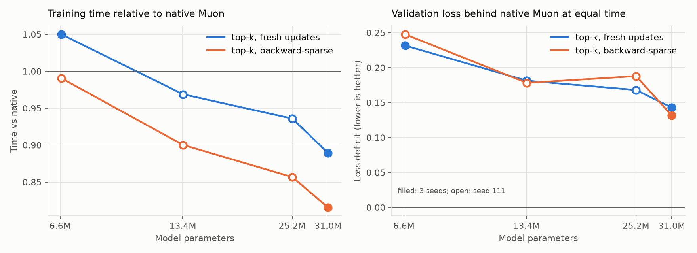

# ATLAS

**Adaptive Topology & Local Activation Stepping**: an experimental approach to neural network
training that spends compute where the network currently needs it, instead of updating every
weight on every step.

> **Status: active research.** This repository describes the idea, the design and what we have
> measured so far. The implementation, tests and full benchmark records will be published when
> the method is complete. Every result below is preliminary, from small models, and labeled
> with the task it came from.

## The idea

A training step normally treats a network as one block: every weight receives a gradient,
and every weight is updated. But at any moment some regions of a weight matrix are changing
quickly while others have mostly settled. ATLAS asks whether a trainer can notice that and
skip work on the quiet regions, first in the optimizer, and then in the forward and backward
passes themselves.

ATLAS splits each weight matrix into **tiles**, gives every tile a **score** for how much it
currently wants to change, and lets a **gate** decide which tiles are worked on this step.
Tiles that are not selected **sleep**. The design questions are what the score should be, how
the gate should choose, what a sleeping tile should do, and how to make skipping work actually
save time.

## Design

### Tiles and coarse-to-fine refinement

Each 2D weight matrix is divided into an R × R grid of tiles. Training starts coarse
(R = 1, the whole matrix) and refines on a schedule (1 → 2 → 4). Refined tiles inherit their
parent's state, so refinement never discards optimizer history.

### Scores

A tile's score is its gradient norm relative to its weight norm, normalized against that
tile's own slowly decaying peak, and scaled by global training progress:

```
ratio    = ‖gradient tile‖ / ‖weight tile‖
score    = ratio / max(ratio, 0.994 · previous peak) · progress^0.45     (clipped to [0, 1])
```

The score is a relative gating signal: "how active is this tile compared with its own
recent history". It is **not** an estimate of how far a weight is from a correct value.

### Gates

- **Budget gate (current default).** The top *k*% of tiles by score update each step, chosen
  across all matrices together. Tiles are full-width bands of rows. This fixes the amount of skipped work by construction.
- **Threshold gate (original).** A tile updates when its score reaches a threshold that adapts
  to the mean score. On transformers this stops gating late in training (see below).

A tile that has slept too long is woken, so no tile can starve.

### What a sleeping tile does

The original design let sleeping tiles **accumulate** their gradients and apply them on
waking with a catch-up multiplier. The current design **drops** them instead: a waking tile
trains on its current gradient. Fresh updates trained better than accumulated ones in every
paired comparison, and they are what make skipping the backward pass possible.

### Skipping the passes

An optimizer-only scheme has a hard ceiling: the forward and backward passes still run. So
ATLAS **plans one step ahead**. After each update the gate chooses which tiles the *next*
step computes, and the network's linear layers skip the rest:

- **Backward-sparse.** The forward pass is exact; only planned tiles' weight-gradient matmuls
  run. This has cost no measurable quality in any run so far.
- **Fully sparse.** Sleeping tiles are also left out of the training forward pass and the
  input gradient. This is the "fuzzy" mode: the network trained on a given step is a sparser
  version of the real one. ATLAS can switch back to full passes when training stalls.

### Seeing sleeping tiles without computing them

A skipped tile has no gradient, so its score goes stale. But its gradient norm has a cheap
upper bound from tensors the backward pass already has:

```
‖dW tile‖ = ‖dYᵀ[rows] · X[cols]‖ ≤ ‖dY[rows]‖ · ‖X[cols]‖
```

Scaling that bound per matrix by the true/bound ratio of the tiles that *were* computed gives
every tile a fresh estimate each step. In practice the calibrated estimate came within about
3–5% of the true gradient-norm ratios, at a small fraction of the cost.

## Engineering lessons

- **Tiles must not mean tiny kernels.** A naive per-tile implementation launched about 16,700
  GPU kernels per optimizer step, against about 1,100 for the native optimizer. Treating each
  matrix's tiles as one strided batch, then batching same-shaped tiles *across* matrices,
  brought ATLAS's optimizer step from 10× slower than native to faster than native.
- **Threshold gates can quietly stop gating.** The adaptive threshold settled at about 60% of
  the mean score while scores rose and bunched together, so nearly every tile cleared it late
  in training. Smoothing the loss signal did not help; a fixed budget does.
- **Regular schedules hurt.** Rotating which tiles update on a fixed cycle trained worse than
  top-*k* even while updating more parameters, and freezing whole matrices for several steps
  at a time was far worse. Irregular selection, whether by score or at random, does not have
  this problem.
- **Row bands beat grids.** Orthogonalizing full-width row bands instead of grid tiles cut the
  quality cost of tiled Muon by about three quarters.
- **Scores seem to matter across matrices, not within them.** At equal update volume, which
  tiles of a matrix update barely matters (top-*k* beat random by 0.004 in one run). But
  letting scores decide how much of the budget each matrix receives beat splitting it
  evenly. Our working hypothesis: scores are for *allocating* work between matrices, and
  placement inside a matrix can be chosen for hardware efficiency.
- **Tune both sides, at every size.** Learning rates that suit one model size can be badly
  off at another, and an untuned baseline can make any method look good.
- **Measure, then guess.** Several plausible speedups (a background planner thread, batching
  only the device-to-host transfers) turned out to be minor or negative once profiled.

## Preliminary results

**Task:** causal language models trained from scratch on TinyStories, six transformer blocks,
on one AMD Radeon RX 7900 XT. Every configuration shares initialization and minibatches
within a seed. ATLAS uses the budget gate at 35% with row-band tiles (full-width blocks of
rows, which keep Muon's orthogonalized direction far better than a grid), fresh updates and
backward-sparse passes.

### Same training time, better model (77.9M parameters)

Width 1024, 77.9M parameters. Both optimizers were tuned at this size (both prefer the default
Muon learning rate) and each runs its own full schedule in the same wall-clock time: native
Muon for 500 steps, ATLAS for 700. Final validation losses are compared directly.

| Seed | Native Muon | ATLAS | ATLAS − native |
| ---: | ---: | ---: | ---: |
| 111 | 2.412 in 46.1 s | 2.370 in 47.6 s | −0.041 |
| 112 | 2.390 in 46.3 s | 2.366 in 47.1 s | −0.024 |
| 113 | 2.390 in 46.9 s | 2.357 in 46.9 s | −0.033 |

**ATLAS produces the better model in the same time in every seed** (mean −0.033). In that time
it takes 40% more steps, each updating about half of the parameters: at this width, Muon's
orthogonalization takes about half of native's training time, and ATLAS skips most of it.

What this does and does not show:

- It is one model size, one dataset and short training (2–3M tokens). The margin is modest.
- The advantage applies when training is limited by **compute**. With a fixed amount of
  data, ATLAS's extra steps are not available and native Muon's better per-step quality wins.
- Learning rates must be re-tuned per size. An earlier comparison at this size against a
  mistuned native baseline looked far more favorable; it was wrong, and we retracted it.

### How the advantage grows with size



From 6.6M to 31M parameters (25% budget, grid tiles), ATLAS gets steadily faster relative to
native Muon: 0.99× its training time at 6.6M, 0.82× at 31M. Muon's orthogonalization grows
with width³ while the forward and backward passes grow with tokens × width², so the work
ATLAS skips becomes a larger share of each step as models widen. At those sizes ATLAS was
still behind at equal time. Those runs used a learning rate tuned at 6.6M for both
optimizers, which the 77.9M results show can be off at larger sizes, so treat the smaller
points as indicative.

## Open questions

- **Does the margin grow with width?** Equal-time comparisons at ~110M and ~150M parameters,
  re-tuning learning rates at each size, are next.
- **Longer training.** All runs so far are short; the comparison needs to hold over much
  longer schedules.
- **The best budget per second.** The budget that loses least per step need not be the one
  that wins most per unit of time.
- **Matrix-level allocation:** scores seem to matter for dividing work between matrices, not
  for placing it inside one; a per-matrix score could replace per-tile scoring.
- **Making sparse forward passes work.** Fully sparse training is the fastest mode, but the
  sparse network drifts from the full one.
- **Fixed-shape steps** would allow GPU graph capture of the whole update.
- Other optimizers, tasks and hardware.

## Credits and license

ATLAS was conceived by Jacob ([hearthlink](https://github.com/hearthlink)), who proposed the
tile metadata, threshold gating, resolution, sparse-pass and scaling ideas. It is developed by
Hearthlink: Jacob working with AI collaborators (Claude, Codex and Gemini). Muon follows its
published Newton–Schulz convention, with PyTorch's implementation as the parity reference.

Licensed under the [GNU General Public License v3.0 or later](LICENSE).
